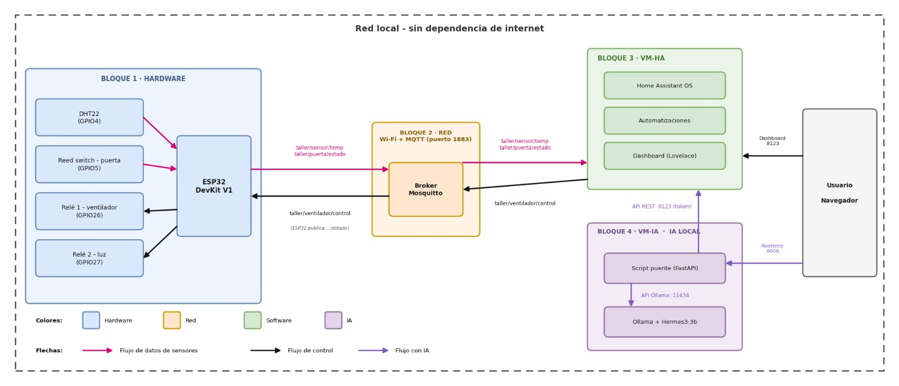

# Domótica local con IA para un taller de trabajo

Trabajo final integrado de Laboratorio de Hardware / Mantenimiento, Conversión y Reparación de Software.
Escuela Industrial Nº 4 "José Menéndez". Docente Lic. Hugo Omar Arias. Año 2026.

Integrantes. Fernanda López y Ruth Lagraña.

## Descripción

El sistema monitorea y controla un taller de trabajo de 15 a 20 m² con un enfoque *Local First*. Todo funciona dentro de la red local y solo se usa internet para la instalación inicial.

Se monitorean tres variables, que son temperatura, humedad y estado de la puerta. La luminosidad se simula con un Helper de Home Assistant. Dos relés controlan un ventilador y una luz auxiliar. Un asistente de IA local (Ollama con Hermes3:3b) responde consultas en lenguaje natural sobre el estado del taller.



## Arquitectura

| Componente | Dónde corre | Función |
| --- | --- | --- |
| ESP32 DevKit V1 (simulado) | Wokwi y simulador en Python | Lee DHT22 y sensor de puerta, acciona dos relés |
| Mosquitto (MQTT, puerto 1883) | VM-HA | Broker de mensajes con usuario dedicado `mqtt_taller` |
| Home Assistant OS | VM-HA (VirtualBox) | Entidades, automatizaciones y dashboard |
| Ollama + Hermes3:3b | VM-IA (Ubuntu Server) | Modelo de lenguaje local |
| `asistente.py` (FastAPI, puerto 8000) | VM-IA | Puente entre Home Assistant y Ollama |

## Estructura del repositorio

```
esphome/        Firmware del ESP32 en YAML (ESPHome, solo MQTT) y plantilla de secretos
wokwi/          Sketch de Arduino, diagrama del circuito y librerías usadas en Wokwi
homeassistant/  Entidades MQTT, automatizaciones y dashboard (Lovelace)
simulador/      Simulador del ESP32 en Python que publica por MQTT
ia/             Script puente FastAPI entre Home Assistant y Ollama
docs/           Diagrama de arquitectura y diagrama de flujo de datos
```

## Conexiones del ESP32

| Componente | Pin del ESP32 |
| --- | --- |
| DHT22 (datos) | GPIO4 |
| Sensor de puerta (reed / slide switch) | GPIO5 con INPUT_PULLUP |
| Relé 1, ventilador | GPIO26 |
| Relé 2, luz auxiliar | GPIO27 |

## Topics MQTT

| Topic | Sentido | Contenido |
| --- | --- | --- |
| `taller/estado` | ESP32 → HA | `online` / `offline` (disponibilidad, last will) |
| `taller/sensor/temp` | ESP32 → HA | Temperatura en °C |
| `taller/sensor/humedad` | ESP32 → HA | Humedad en % |
| `taller/puerta/estado` | ESP32 → HA | `ON` abierta, `OFF` cerrada |
| `taller/ventilador/control` y `/estado` | HA ↔ ESP32 | `ON` / `OFF` |
| `taller/luz/control` y `/estado` | HA ↔ ESP32 | `ON` / `OFF` |

## Automatizaciones

1. **Ventilador por calor.** Se enciende si la temperatura supera 28 °C y la puerta está cerrada.
2. **Apagado del ventilador.** Se apaga si la temperatura baja de 26 °C o se abre la puerta (histéresis).
3. **Luz al entrar.** Se enciende si se abre la puerta y la luminosidad es menor a 20 lx.
4. **Apagado de la luz.** Se apaga dos minutos después de cerrar la puerta.

Las reglas 1 y 3 son las que cumplen la consigna de dos condiciones. Las reglas 2 y 4 evitan que los actuadores queden encendidos.

## Puesta en marcha

### Home Assistant
1. Agregar el contenido de `homeassistant/mqtt_entidades.yaml` al final de `configuration.yaml`.
2. Copiar `homeassistant/automations.yaml` y recargar las automatizaciones.
3. Crear el Helper numérico `input_number.luz_taller` (0 a 1000 lx).
4. Pegar `homeassistant/dashboard_taller.yaml` en el editor de configuración sin procesar del panel.

### ESPHome
Copiar `esphome/secrets.example.yaml` como `secrets.yaml`, completar los valores y compilar `taller-esp32.yaml`.

### Simulador del ESP32 (PC anfitriona, Windows)
```powershell
cd simulador
python -m venv venv
venv\Scripts\activate
pip install -r requirements.txt
$env:MQTT_BROKER = "IP_DE_HOME_ASSISTANT"
$env:MQTT_USER   = "mqtt_taller"
$env:MQTT_PASS   = "CLAVE_DE_mqtt_taller"
python simulador_esp32.py
```
Comandos `t 31` (temperatura), `h 70` (humedad), `p` (abrir o cerrar puerta), `a` (modo automático), `s` (estado) y `q` (salir).

### Asistente de IA (VM-IA, Ubuntu Server)
```bash
cd ia
python3 -m venv venv && source venv/bin/activate
pip install -r requirements.txt
cp .env.example .env && nano .env && chmod 600 .env
set -a && source .env && set +a
uvicorn asistente:app --host 0.0.0.0 --port 8000
```
La interfaz queda en `http://IP_DE_LA_VM_IA:8000`. La imagen de fondo opcional va en `ia/static/fondo.jpg`.

## Seguridad

- Usuario MQTT dedicado (`mqtt_taller`), sin permisos de administrador y sin acceso anónimo al broker.
- El token de Home Assistant y las claves se guardan en `.env` y `secrets.yaml`, que están excluidos por `.gitignore`.
- El servidor del asistente publica solo la carpeta `ia/static/`, no el directorio con el `.env`.
- Firewall `ufw` en la VM-IA. El puerto 11434 solo acepta conexiones desde la VM-HA.
- El asistente solo lee estados. No llama a servicios de Home Assistant, por lo que no acciona relés.

## Simulación de Wokwi

https://wokwi.com/projects/479063478001915905
